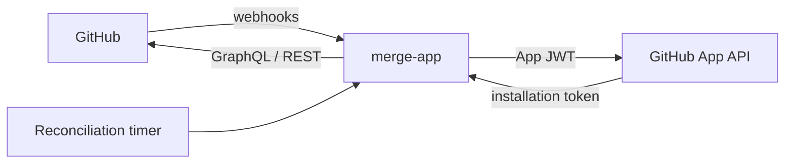
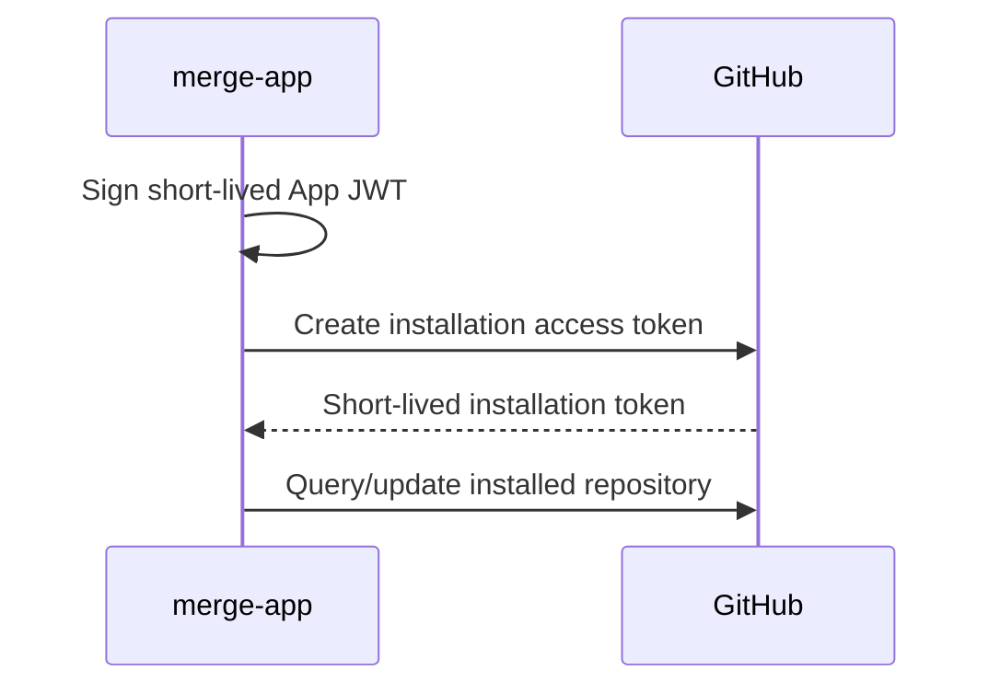

# Merge App — Design Proposal

**Status:** Proposal

## Summary

`merge-app` is a small self-hosted GitHub App that provides a serialized merge queue on top of GitHub native auto-merge.

The app preserves the existing `merge-action` model:

> GitHub owns approvals, required checks, branch protection, auto-merge, and the final merge. `merge-app` only decides which eligible pull request may advance and rebases that pull request onto the latest base branch when required.

Repositories participate by installing the GitHub App and enabling auto-merge on pull requests. The public project is the application binary; how an operator deploys, exposes, and supervises it is intentionally outside the initial project scope.

The design avoids OAuth, per-repository PATs, persistent queue state, Redis, and a database. GitHub remains the source of truth.

## Goals

- Preserve the serialized merge behavior of `merge-action`.
- Continue using GitHub native auto-merge as the actual merge mechanism.
- Replace per-repository PATs with GitHub App installation credentials.
- Support installation by a small allowlisted set of GitHub users or organizations.
- Request the minimum practical GitHub permissions.
- Avoid persistent application state where GitHub can remain authoritative.
- Recover automatically from restarts and missed webhook deliveries.
- Keep the binary straightforward to self-host.

## Non-goals

The initial version will not:

- merge pull requests directly;
- enable auto-merge on behalf of users;
- bypass repository rules;
- manage CI;
- create synthetic approvals;
- provide a general-purpose merge queue configuration language;
- provide end-user OAuth/login;
- provide a web dashboard;
- require a persistent canonical queue;
- prescribe a particular hosting, ingress, TLS, container, or service-manager setup.

## High-level architecture



The application is a single Rust service exposing an HTTP webhook endpoint and running a periodic reconciliation loop.

Webhook events provide low-latency notification that repository state may have changed. GitHub itself remains durable state. Reconciliation repairs missed webhook deliveries or work lost during a restart.

## GitHub App model

The GitHub App is public so that it can be installed on accounts other than the account that owns the App. It does not need to be published in GitHub Marketplace.

User OAuth authorization is not required. Installing a GitHub App grants the App installation access to selected repositories independently of OAuth user authorization.

### Installation allowlist

The service is intended for the maintainer and a small number of explicitly authorized users or organizations.

Configuration stores stable numeric GitHub account IDs rather than usernames:

```toml
allowed_accounts = [
    1234567,
    7654321,
]
```

On `installation.created`:

1. Verify the webhook signature.
2. Inspect `installation.account.id`.
3. Keep the installation if the account is allowlisted.
4. Otherwise immediately remove the installation using the GitHub App API.

For an organization installation, authorization applies to the organization account, not the individual person who initiated the installation. GitHub remains responsible for determining which organization members may install Apps.

No application user database or OAuth flow is required for this model.

## Authentication

The service requires:

- GitHub App ID;
- GitHub App private key;
- webhook secret.

No OAuth client secret or user token is required.

For repository operations:



Webhook payloads identify the installation. Installation tokens should be cached in memory until shortly before expiry rather than minted for every API request.

## GitHub permissions

The target permission set is:

| Permission | Access |
| --- | --- |
| Repository metadata | Read (implicit) |
| Contents | Read/write |
| Pull requests | Read/write |

GitHub requires both Contents: write and Pull requests: write for the
`updatePullRequestBranch(updateMethod: REBASE)` mutation. Do not request
Administration, Actions, or any other permission.

### Rebase API validation

The implementation calls GitHub GraphQL's `updatePullRequestBranch` mutation
with an expected head OID and the `REBASE` update method.

Live Phase 0 testing established that the App and repository-scoped installation
token need Contents: write and Pull requests: write. The validator must confirm
both permission sets before it makes pull request calls. It must also confirm
that GitHub rejects a deliberately mismatched expected head OID without
changing the PR, then verify a real rebase and preservation of native auto-merge.

The validator recognizes GitHub's `head sha didn't match the current head ref.`
response as the expected-head race. Mixed or unrelated GraphQL errors remain
failures.

## Repository eligibility

A repository is managed when:

- the App is installed for the repository; and
- its installation account is allowlisted.

No repository-side configuration file is required initially.

Repositories are expected to configure GitHub native auto-merge and branch/ruleset protection appropriately, including required CI and review policy. Each managed base branch must require strict required checks: the branch must be up to date before GitHub can merge a pull request. In classic branch protection, enable “Require branches to be up to date before merging.” Configure the equivalent requirement in rulesets.

This keeps a pull request behind the base branch blocked in GitHub while the worker rebases it. GitHub then waits for required checks on the updated branch before native auto-merge can proceed.

## Pull request eligibility

A pull request is a queue candidate when it is:

- open;
- not a draft;
- approved according to GitHub's current review state; and
- configured for GitHub native auto-merge.

The app does not infer whether a PR "should" merge beyond those conditions. Repository rules remain authoritative.

## Event model

Webhook events do not represent durable queue entries. They mean:

> Something changed in this repository; recompute its current state.

The required GitHub App webhook subscriptions are:

- `installation`;
- `installation_repositories`;
- `pull_request`;
- `pull_request_review`;
- `push`.

Every valid, authorized `pull_request`, `pull_request_review`, and `push` delivery
marks its repository dirty, regardless of action. These events are broad signals
that repository state may have changed. They do not imply that the worker will
mutate a pull request. A push can update a base branch directly. A pull request head
push can also produce both `push` and `pull_request` deliveries; the repository
coordinator coalesces the resulting work.

When the queue-head pull request merges, its `pull_request.closed` event causes the
worker to reconsider the repository. The next eligible pull request can then
advance.

Workers query GitHub for current queue state after a dirty signal. GitHub's
`reviewDecision` remains authoritative; webhook payloads do not supply queue state
or mutation instructions. The full periodic reconciliation repairs missed webhook
deliveries and interrupted work.

## Queue algorithm

`advance(repository)` reconstructs queue state entirely from GitHub.

Conceptually:

```text
eligible =
    open
    && !draft
    && approved
    && auto_merge_enabled

candidates = eligible PRs ordered oldest-first

for candidate in candidates:
    if mergeability == CONFLICTING:
        continue

    if mergeability == UNKNOWN:
        return

    if candidate is up-to-date:
        return

    if candidate is behind:
        rebase candidate onto base
        return
```

This intentionally preserves the existing serialized behavior:

- conflicting PRs are skipped;
- unresolved mergeability prevents a younger PR from overtaking the candidate;
- only one queue candidate is updated per pass;
- after a rebase, normal CI and review policy run again;
- a PR whose required CI fails remains the queue head while it remains eligible;
- GitHub auto-merge performs the actual merge;
- a subsequent repository event advances the queue again.

The service does not poll CI to decide when to merge. GitHub's auto-merge machinery remains responsible for waiting for all required checks and rules.

### Race protection

Every rebase should include the observed head SHA/OID as a compare-and-swap condition.

If the PR head changes between observation and mutation, the mutation should fail and the repository should simply be recomputed.

This makes concurrent human activity safe without introducing application-side transactional state.

## Concurrency

Only one `advance()` operation may execute for a repository at a time.

For the initial single-process deployment this can be implemented in memory:

```text
repository_id -> mutex / repository worker
```

Webhook bursts should be coalesced rather than creating an unbounded work queue. A suitable model is:

```text
event
  -> mark repository dirty
  -> ensure repository worker scheduled
  -> worker runs advance()
  -> if dirtied while running, run again once
```

This gives each repository serialized execution while allowing unrelated repositories to progress concurrently.

A single-process deployment therefore needs no Redis, database, or distributed lock.

If horizontal scaling is supported later, repository serialization must move to a distributed primitive before multiple service replicas process events concurrently.

## Webhook handling

The service exposes a public HTTP endpoint, for example:

```text
POST /github/webhook
```

Processing should be minimal:

1. Read a bounded request body.
2. Verify `X-Hub-Signature-256` using the webhook secret.
3. Identify the event type and validate the fields needed to identify its
   installation and repository.
4. For each valid pull request, review, or push delivery, mark an authorized
   repository dirty regardless of action. Process installation lifecycle events
   with their existing action handling.
5. Return promptly.

The application should record `X-GitHub-Delivery` and may maintain a small in-memory LRU of recent delivery IDs to suppress immediate duplicates. Correctness must not depend on deduplication.

Unknown event types should be ignored safely after signature verification.

## Reliability and reconciliation

A durable webhook/event queue is deliberately avoided.

GitHub is the durable state store. Workers reconstruct queue state from GitHub
when work is scheduled, so the service does not need to replay every event.

The service runs a full reconciliation:

- immediately at startup to reconstruct state after a restart;
- immediately when an installation lifecycle webhook reports an access change;
- every `reconcile_interval` as a safety sweep.

The periodic interval defaults to one hour and remains configurable. This is a
safety interval, not an SLA for normal queue progress. Repository webhooks are
the normal low-latency trigger. Targeted retries recover transient queue states.

Reconciliation:

1. list active App installations;
2. remove or ignore unauthorized installations;
3. enumerate repositories accessible to each authorized installation;
4. invoke `advance()` for each repository.

Because `advance()` reconstructs state from GitHub, losing in-memory work during a crash does not lose queue state.

The resulting model is:

```text
webhooks = normal low-latency queue trigger
targeted retries = transient-state recovery
GitHub = durable state
startup reconciliation = restart reconstruction
periodic reconciliation = missed-event and lifecycle repair
```

## Configuration

The binary should keep configuration intentionally small. For example:

```toml
listen = "0.0.0.0:8080"
reconcile_interval = "1h"

allowed_accounts = [
    1234567,
    7654321,
]
```

Secrets should be supplied separately from ordinary configuration:

```text
GITHUB_APP_ID
GITHUB_APP_PRIVATE_KEY
GITHUB_WEBHOOK_SECRET
```

The private key should support being read from a file so deployers can use their preferred secret-management mechanism without placing PEM data directly in configuration.

The project should not prescribe how the binary is exposed to the public internet, where TLS terminates, or whether it runs under Docker, Podman, systemd, Kubernetes, or another environment.

## Observability

Structured logs should include, where applicable:

- installation ID;
- repository ID and name;
- pull request number;
- webhook delivery ID;
- triggering event;
- queue decision;
- observed head/base SHA;
- resulting head SHA after rebase;
- GitHub API failures.

Useful decisions include:

```text
repo=dstoc/example action=no_candidates
repo=dstoc/example pr=42 action=wait_up_to_date
repo=dstoc/example pr=43 action=skip_conflict
repo=dstoc/example pr=44 action=rebase old_head=...
repo=dstoc/example action=mergeability_pending
```

No external metrics system is required initially.

A local health endpoint may be provided for deployers, but it is not part of the GitHub protocol.

## Security boundary

The App needs Contents: write because GitHub requires it for a server-side PR
branch rebase. This permission is broader than the rebase mutation. The service
uses it only when it calls `updatePullRequestBranch` with `REBASE`; the service
does not call repository content write APIs or merge pull requests.

The intended credential may:

- inspect PR state;
- update PR state within the Pull Requests permission;
- request a server-side PR branch update/rebase.

The App also has Contents: write, which GitHub requires for the rebase mutation.
The App should not have:

- Actions write;
- Administration permission;
- branch-protection bypass.

GitHub remains responsible for deciding whether the resulting PR satisfies the repository's rules and may merge.

The Contents permission increases the impact of a compromised queue worker.
Keep its token repository-scoped, and keep the service's GitHub calls limited to
the queue operations described here. GitHub still applies repository rules
when it performs the rebase and decides whether native auto-merge can proceed.

## Migration from merge-action

### Phase 0 — API spike

Create a test GitHub App and prove:

- App JWT authentication;
- installation-token authentication;
- PR state queries;
- GraphQL server-side rebase;
- Contents write and Pull Requests write for the rebase mutation;
- expected-head race protection;
- preservation of native auto-merge after an App-initiated rebase.

The permission model should not be considered settled until this passes.

### Phase 1 — Core service

Implement:

- App JWT signing;
- installation-token cache;
- GitHub API/query layer;
- the existing queue algorithm;
- per-repository serialization;
- reconciliation loop.

Exercise it against test repositories without relying on webhooks.

### Phase 2 — Webhooks and installation lifecycle

Add:

- HMAC validation;
- installation allowlist enforcement;
- PR/review event handling;
- dirty-repository scheduling;
- delivery logging and lightweight deduplication.

### Phase 3 — Self-hosted release

Publish the Rust binary and/or project-supported container image together with documentation describing:

- required GitHub App settings;
- required permissions and webhook subscriptions;
- configuration and secrets;
- health endpoint, if implemented;
- requirement for the webhook endpoint to be publicly reachable over HTTPS.

Specific hosting or ingress products remain deployer choices.

### Phase 4 — Parallel validation

Install the App on one repository while retaining the existing Action as a manual fallback.

Do not allow both systems to automatically rebase the same repository concurrently.

Verify event transitions, permission boundaries, restart recovery, and failure cases. Include this strict-check case:

1. Enable strict required checks on the managed base branch.
2. Make two eligible pull requests against the same base and enable auto-merge on both.
3. Merge the first pull request.
4. Confirm the second pull request stays blocked while its branch is behind.
5. Confirm the worker rebases the second pull request and GitHub waits for required checks on the updated branch before auto-merging it.

### Phase 5 — Repository migration

For each repository:

1. install the GitHub App and grant repository access;
2. require strict required checks on each managed base branch, using the branch protection or ruleset setting that requires branches to be up to date before merging;
3. verify reconciliation sees the repository;
4. disable/remove the `merge-action` caller workflow;
5. remove `PR_GH_TOKEN`;
6. retain the existing branch/ruleset protection and GitHub auto-merge settings, including required CI and review policy.

## Future extensions

The architecture leaves room for later additions without requiring them initially:

- optional per-installation or per-repository configuration;
- queue position/status reporting;
- status page;
- configurable ordering or priority labels;
- pause/resume repository processing;
- webhook redelivery/recovery tooling;
- multiple replicas with distributed serialization.

These should only be added when there is a concrete need.

## Decision summary

The proposed service is intentionally a thin hosted version of `merge-action`:

```text
GitHub webhook
      ↓
mark repository dirty
      ↓
serialize by repository
      ↓
reconstruct queue from GitHub
      ↓
rebase at most one PR
      ↓
GitHub CI / reviews / auto-merge
```

The application owns scheduling, not merging.

GitHub remains the durable state store and policy engine. Webhooks provide responsiveness, reconciliation provides reliability, and GitHub App installations provide repository-scoped authentication.

The public project is the binary and its GitHub integration. Deployment architecture is deliberately left to the operator.
